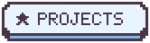
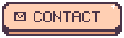
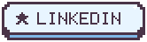
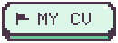

<!-- The banner follows your GitHub theme: daytime picnic in light mode, the gang falls asleep in dark mode. -->
<picture>
  <source media="(prefers-color-scheme: dark)" srcset="assets/banner_night.svg">
  
</picture>

  

  
  
  
  

☀️ light mode = picnic time &nbsp;·&nbsp; 🌙 switch GitHub to dark mode and the cats fall asleep

## ✿ about me

**สวัสดี! 👋** I'm **Sidaporn**, a Data Science & Business Analytics student at **KMITL** who likes turning messy data into things people can actually use: LLM agents, chatbot analytics, risk maps and a whole fossil atlas.

- 🎓 B.Sc. Information Technology – Data Science and Business Analytics, **KMITL** (2023 – present)

## 🌟 projects

<table>
  <tr>
    <td width="50%" valign="top">
      
      <b>Project Jurassic</b> Thailand fossil atlas · senior project
       
      Predicts where fossils are likely to be found and identifies what you found. AUC <b>0.887</b> on unseen areas, with in-browser ONNX models on Cloudflare. 
      <a href="https://github.com/hakunamatataIpaperanya/project-jurassic">repo</a> · <a href="https://project-jurassic.roject--urassic.workers.dev">live demo ↗</a>
    </td>
    <td width="50%" valign="top">
      
      <b>Discovery Piscine @ 42 Bangkok</b> python bootcamp · side quest
       
      From the very first <code>print(42)</code> to the final boss, <b>RUSH: Checkmate</b>, all logged as a pixel adventure. 
      <a href="https://github.com/hakunamatataIpaperanya/CWP-sjitrave">repo</a>
    </td>
  </tr>
</table>

## 🎒 inventory

## 💌 say hi

  
  
  

